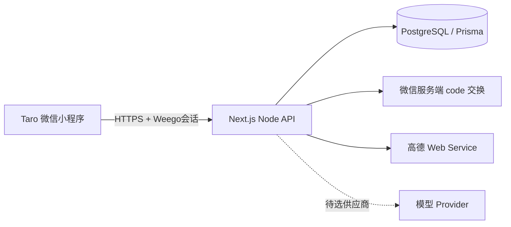

# 当前架构与验收边界

更新：2026-10-24。历史交接记录中的早期“尚未实现/未连库”以本页及实际代码、当前Issue进展为准。

客户端在apps/miniprogram；API在apps/web。packages/contracts是唯一前后端结构校验入口，packages/api-client使用可注入传输，平台层接Taro.request。prisma维护模型和迁移。Next采用standalone容器候选，不因独立云函数探针成功迁移为云函数业务后端或文档库。

## 身份与业务流程

wx.login的临时code只发服务端；服务端验证后以AppID＋OpenID唯一映射独立user_id。随机Weego会话仅在数据库保存SHA-256摘要，过期重新登录。当前管理者从数据库检查，客户端昵称、活动ID或微信身份头不授权限。

创建多环节活动时明确唯一主环节与本人参加选择，管理者可不参加。成员选择本次新增环节并接受当前安排 → 提交申请（不占位）→ 当前管理者整体批准 → 一个事务取得全部目标席位。任一目标截止、版本、名额不满足则整笔失败。活动锁、Serializable事务及操作者/语义绑定的幂等记录保护重试和并发；不把达到最低或满员当作已经成局。

## 实际实现与证据

| 能力 | 当前状态 |
|---|---|
| 小程序 | 首页、创建、活动详情、选段申请、整体批准/拒绝、技术检查入口；编译通过，正式真机未验 |
| 业务API/PG | 身份会话骨架、创建/详情/申请/审批；独立本机PG17.11两条迁移成功 |
| 本机真实检查 | 12项PG/HTTP检查及4项实际重启检查通过，覆盖并发最后席位、第二席位故障完整回滚与持久化 |
| 离线回归 | 90项，另有类型检查与双端构建；真实PG脚本按显式目标单独执行 |
| 微信 | 服务端交换代码已实现，AppSecret和正式真实微信交换/重登/双机尚未验收；PG测试用户/会话为fixture |
| 地图 | 高德服务端搜索/附近/步行路由、输入校验、超时脱敏及基础限流；共享客户端已接。小程序选择器待接 |
| AI | 严格结构化契约和纯函数约束校验，未选模型、未调用或应用真实建议 |
| 部署 | 本机Windows standalone已运行；Linux镜像由CI验证。云托管/云端PG与合法调用入口未落实 |

地图密钥仅服务端持有。返回带来源和查询时间，未知库存/预订保持未知，餐饮人均不能当运动小时场租，步行估计不含室内和活动缓冲。基础限流为单进程，部署多副本需共享限流/配额控制。

AI保留地点，建议绑定活动与各段版本，检查已开始/取消/固定后段、相邻时间及未知转场，展示差异、影响人与未知项。校验成功仍只供人工审阅，未来应用端须在事务内重新核权限、版本和完整写入。合成样例不是模型成绩。

## 后续接通顺序

1. 落实已有微信Secret的安全配置、正式身份交换及同微信恢复；不擅自重置原Secret。
2. 明确云端独立PG、持久化/备份、运行周期与费用边界，落实HTTPS或单验callContainer；不能把手机localhost或跳过校验作为验收。
3. 两个具备体验资格的微信在普通模式使用同一真实后端，验证身份隔离、重启/前后台与业务流程。
4. 按12张Issue补邀请归因/二维码/名单、成局/退出/变更重接受/交接、地图选择器、真实AI、分享卡/待办/再约。精细界面与试用改进按比赛安排继续。

上传源码不等于上传小程序体验版或正式发布。没有付费、改名、重置原账号或更换数据库架构的默认授权。
