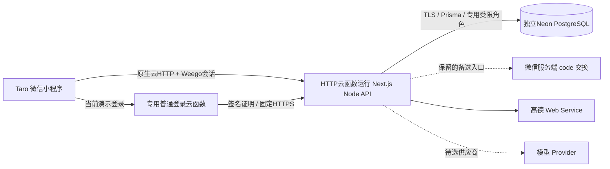

# 当前架构与验收边界

更新：2026-10-25。历史交接记录中的早期“尚未实现/未连库”以本页及实际代码、当前Issue进展为准。

客户端在apps/miniprogram；API在apps/web。packages/contracts是唯一前后端结构校验入口，packages/api-client使用可注入传输，平台层支持Taro.request与原生wx.cloud.callHTTPFunction。prisma维护模型和迁移。当前演示将Linux standalone放入独立HTTP云函数；路由、PG事务、业务权限均保留，并未改为文档数据库。该承载不使用CloudBase Run，容器方案仍保留。

当前部署为受现有套餐约束的演示环境：CloudBase于2026-11-04到期、自动续费及超限按量关闭；Neon采用Free独立项目，存在休眠和配额限制。登录函数到API使用现有默认开发测试域名，仅限当前测试用途，稳定性与频率存在限制。运行期限、备份恢复与真机冷启动仍需落实，详见[部署说明](./deployment.md)。

## 身份与业务流程

普通方式将wx.login临时code只发服务端；可选云方式由专用函数读取当前平台context并经固定HTTPS向API提交Ed25519签名证明。API验证固定应用/环境/受众/有效期，在同一PG事务中消费一次性digest、映射AppID＋OpenID及签发会话。云方式默认关闭、需显式配置；客户端只收到Weego会话，不取得原始身份证明，失败不自动切换身份方式。两条方式均复用独立user_id和数据库SHA-256会话摘要，管理权每次查询服务端；客户端昵称、活动ID或微信身份头不授权限。

创建多环节活动时明确唯一主环节与本人参加选择，管理者可不参加。成员选择本次新增环节并接受当前安排 → 提交申请（不占位）→ 当前管理者整体批准 → 一个事务取得全部目标席位。任一目标截止、版本、名额不满足则整笔失败。活动锁、Serializable事务及操作者/语义绑定的幂等记录保护重试和并发；不把达到最低或满员当作已经成局。

## 实际实现与证据

| 能力 | 当前状态 |
|---|---|
| 小程序 | 正式开发工具实际点击登录两次、同身份新会话、创建→详情→首页本人记录恢复通过；选段申请/整体审批页面已实现，双微信真机另验 |
| 业务API/PG | 独立HTTP云函数运行Next.js；独立Neon PG17.11全部三条迁移成功；运行角色仅应用表CRUD，不持owner权限 |
| 本机真实检查 | 12项PG/HTTP检查及4项实际重启检查通过，覆盖并发最后席位、第二席位故障完整回滚与持久化 |
| 离线回归 | 162项，另有类型检查与双端构建；Linux CI还验证真实临时PG、重启、容器与SCF ZIP解压启动 |
| 云端PG | 本机API连接实际Neon通过5组、21次HTTP请求，包括nonce并发、身份映射、多段整体审批及最后席位无超卖；使用fixture身份并精确清理，不冒充手机结果 |
| 微信 | 实际正式开发工具3.16.2、urlCheck=true下，原生云HTTP的health/ready均200；真实云登录两次恢复同一业务身份、分别签发新会话且/me200。未取得原AppSecret；双微信真机尚未验收 |
| 地图 | 高德服务端搜索/附近/步行路由、输入校验、超时脱敏及基础限流；共享客户端已接。小程序选择器待接 |
| AI | 严格结构化契约和纯函数约束校验，未选模型、未调用或应用真实建议 |
| 部署 | 云端Next health/ready及PG已连通；云登录私钥和API公钥分开，旧服务未动。默认测试域名、套餐期限和免费库休眠限制仍存在 |
| 恢复 | 已对本次独立Weego库生成受保护备份并在全新本机隔离库恢复，12张应用表、3条迁移匹配；快照不含其后的新写入，不代表自动备份已建立 |

地图密钥仅服务端持有。返回带来源和查询时间，未知库存/预订保持未知，餐饮人均不能当运动小时场租，步行估计不含室内和活动缓冲。基础限流为单进程，部署多副本需共享限流/配额控制。

AI保留地点，建议绑定活动与各段版本，检查已开始/取消/固定后段、相邻时间及未知转场，展示差异、影响人与未知项。校验成功仍只供人工审阅，未来应用端须在事务内重新核权限、版本和完整写入。合成样例不是模型成绩。

## 后续接通顺序

1. 用两个具备资格的真实微信验证身份隔离、前后台、会话恢复及申请/整体审批闭环；正式开发工具的界面登录、创建与本人记录恢复已通过，仍不替代真机。
2. 记录云函数与免费数据库冷启动、连接数、限流、过期记录清理及备份恢复；到期前明确后续资源，不自动升级或续费。普通code路线保留，不擅自重置旧Secret。实现/配置见[云身份说明](../../cloudfunctions/weegoLogin/README.md)。
3. 体验版本上传需单独核对目标与版本；临时预览、源码PR和体验上传分别记录，不能称已正式发布。
4. 按12张Issue补邀请归因/二维码/名单、成局/退出/变更重接受/交接、地图选择器、真实AI、分享卡/待办/再约。精细界面与试用改进按比赛安排继续。

上传源码不等于上传小程序体验版或正式发布。没有付费、改名、重置原账号或更换数据库架构的默认授权。
