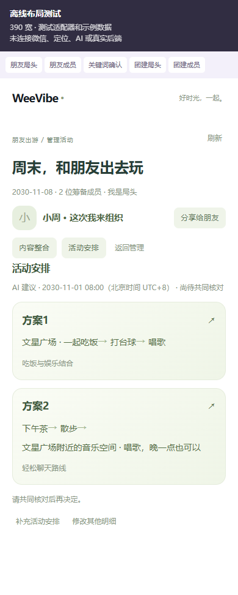
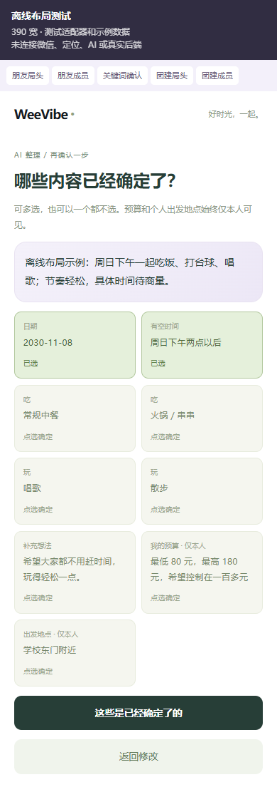
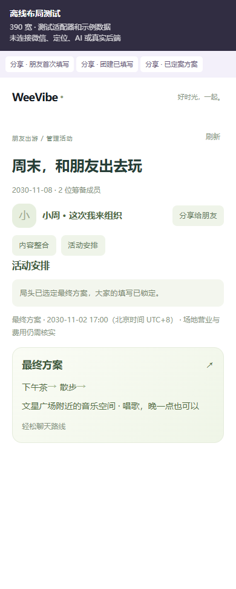

# HTML 版朋友出游与团建

2026-10-28。开发分支 `codex/html-outing-team`，基于 main `43b99fe`；不包含已被用户搁置的 Ecold07 改动。本页描述待审查代码，尚未合并或升级共享演示环境。

## 产品行为

首页和“我的”的“正在筹备”读取服务端真实记录，点击继续管理；主页朋友出游、一起团建及中央创建入口都使用新流程。新页面沿用用户 HTML 的三张设置卡、关键词词库、表单/访谈模式、问卷设计与题库、试填、保存/取消行为。HTML 只是前端参考，其离线模拟没有用作真实 AI 或保存实现。

- 朋友出游：每个人完成 AI 整理后多选已经确定的关键词。零选按钮为“还都没确定”，有选择则为“这些是已经确定了的”。确定状态由本人选择，模型不能代选。
- 管理朋友出游：局头先见“内容整合 / 活动安排”，其他成员常规管理入口直接看内容整合；已填写者从分享卡片进入时均先见这两个管理入口。已加入成员看彼此头像、昵称、公开关键词及已确定标识；个人预算与个人出发地点仅本人可见，局头也不能读取。
- 局头点击“人齐了，生成安排！”并确认，真实模型生成 2–3 套完整备选方案。每张方案卡展示顺序路线，点开后逐项查看安排；例如吃饭 → 台球 → 唱歌。用户提及的文星广场仅作为测试示例，没有写成产品默认地点。
- 未生成时所有人看到“暂未生成”。成员或公开想法变化会将旧安排标记为待重新生成；失败保留原方案。生成备选后，每人仍可修改本人内容；局头在方案详情点击“确定采用这套方案”并确认后，选定最终方案，停止所有新填写、加入、信息修改和重新生成；自己的内容仍可只读查看。定案对同一方案的原请求自然幂等，不能借旧方案或迟到模型结果覆盖最终选择。方案不自动报名、占位、成局、预订或付款。
- 团建：局头设计并发布问卷、看匿名统计；参与者只看局头已确认的信息和本人的答卷。私密题不进入统计，文字及“其他”原文仅本人可见，局头只看填写人数。截止后自己的答卷仍可只读查看。
- 分享入口需真实微信身份。未填 AI 整理的朋友直接进入整理，显式提交后原子加入并保存，再到双入口管理页；已填者直接到双入口管理页。团建未填者直接进入问卷，提交后到活动安排；已填者直接到活动安排，通过“查看我的填写”查看、修改本人答卷。打开分享只读，不隐式加入，提交失败不留下空成员；未加入不能读取成员名单，定案后可看最终安排。

## 实现

`apps/miniprogram/src/features/gatherings` 为新模块，页面入口为 `/pages/gathering/index`。保留现有账号、云登录、cloud-http、头像、地图与精确定位能力；定位仍由用户主动点击请求。旧正式活动、审批记录与历史筹备数据不删除或改写。新流程不自动把方案转为正式活动，旧活动流程仍可查看历史记录。

服务端入口为 `/api/v1/gatherings`，提供创建、读取、显式加入、原子提交并参与、保存本人想法、修改公共信息、成员分页、AI 整理、生成安排和确定最终方案。使用现有真实鉴权；角色和私密投影在服务端执行，其他成员的私密 JSON 不会被名单查询选取。

新数据模型 `Gathering / GatheringMember / GatheringGeneration` 使用第 13 条追加迁移 `20261028160000_gathering_html_flows`；第 14 条 `20261028173000_gathering_final_choice` 增加服务端最终选择与锁定状态（前 13 条未改）。创建与本人保存、生成均有幂等处理；答卷同时检查本人版本和活动版本。问卷有人提交后不允许改题。生成前固定所有成员和公开信息的指纹，供应商返回后复验；生成期间加入的人不会遗漏后悄悄应用旧方案。处理中请求有租约，超时允许核对并重新生成。

模型只收到公开内容，去除实际用户 ID、昵称、头像、预算和出发地点；不发送私密题。供应商使用现有服务端配置，超时、大小和结构有界，原始回复不入仓。所有方案需经过日期、先后时间、最晚结束时间及隐私检查；不能编造具体商家、地址或费用事实。账号切换时快照和列表绑定原会话，旧响应不会呈现给新账号；未知写入保留原请求，重放不重复调用模型。

## 验证证据

- 全工程类型检查通过；197 个测试文件、3892 项测试通过，含本次 187 项模块测试；包含公共定位编译抽取的 3 项新增产物检查回归。未重跑既有双微信基础业务和手机精确定位验收。
- API standalone 构建及 Prisma WASM 产物门禁通过；小程序 demo 构建与实际 cloud/精确定位产物门禁通过（沿用原有活动页大包提示）。
- 隔离的本机 PostgreSQL 17.11 初版 13 条迁移及 15 组真实服务/并发检查已通过；新增分享和定案功能后，另建全新临时库实际应用全 14 条迁移，真实 Request/Response handler 与哈希会话的 11 组 HTTP/事务检查通过，包含原子提交、权限、私密投影、版本冲突、幂等、定案锁定、迟到生成拒绝和数据库约束。复用未受影响的旧 15 组证据，不重复执行。使用新增 `scripts/check-gathering-integration.ts` / `check-gathering-http.ts`，已加入 CI。隔离库已停止，共享库未改。
- 真实供应商仅使用合成公开输入：AI 整理通过；生成返回 3 套方案、每套 3 个顺序环节，结构与时序隐私校验通过。未发送真实个人信息或私密测试字段，也未写共享业务数据。
- 390×844 初版 8 个浏览器离线状态检查通过；新增本人只读、分享首填、团建已填落地、最终选定方案 4 个状态另行通过，无横向溢出，覆盖朋友局头/成员、方案/环节、零选/多选确认、团建局头/参与者。下图明确标为离线布局测试；使用真实 React 页面配测试原生适配器，不代表微信原生、真实接口或手机联调验收。

## 集成顺序

待代码与 CI 审查完成后，维护者确认本次合并、共享 API 升级和第 13、14 条迁移。升级前须核对目标、备份和恢复演练，并给既有运行角色仅补新 3 表的必要 CRUD；不提升为管理账号。先部署新后端并核对运行包与新接口，再上传同源码的小程序临时预览。原生开发工具存在旧 compile 缓存，上新预览前只清项目 compile 缓存，不清登录或存储。

仅构建客户端不会给共享 API 增加新接口。当前共享 API 尚无本模块，不能将仍指向旧后端的二维码宣称为可用联调预览。本轮未替换体验版、提审或正式发布；新流程手机操作待后续新预览反馈。回退应用不回滚/删除新增表或用户记录。
